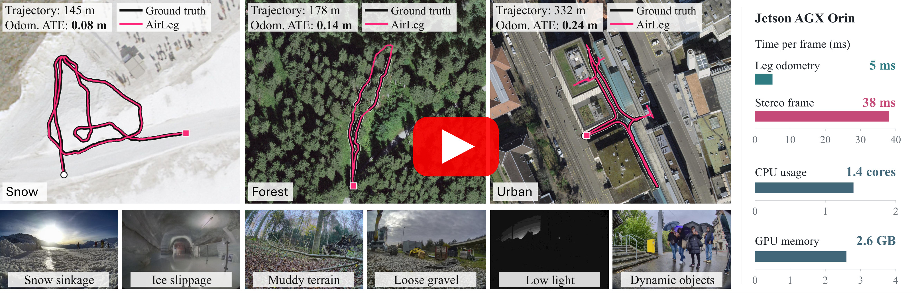

<h1 align="center">AirLeg: A Robust and Accurate Self-Supervised Visual-Inertial-Leg SLAM System</h1>

<p align="center"><strong>
    Kuan Xu<sup>1</sup>,
    Tianxin Hu<sup>1</sup>,
    Ruofei Bai<sup>1,2</sup>,
    Ruimeng Liu<sup>1</sup>,
    Yuefan Hao<sup>3</sup>,
    Zeyu Jiang<sup>1</sup>,
    Zitong Zhan<sup>3</sup>,
    Shenghai Yuan<sup>1</sup>,
    Chen Wang<sup>3</sup>,
    Lihua Xie<sup>4</sup>
</strong></p>

<p align="center">
    <sup>1</sup>CARTIN, Nanyang Technological University&nbsp;&nbsp;
    <sup>2</sup>A*STAR IAIC&nbsp;&nbsp;
    <sup>3</sup>SAIR Lab, University at Buffalo<br>
    <sup>4</sup>NTU-VinUni Joint Research Laboratory for Robotics and Embodied AI
</p>

<p align="center"><strong>
    <a href="https://arxiv.org/pdf/2611.32523v1">&#128196; [Paper]</a> |
    <a href="https://sairlab.org/AirLeg_homepage/">&#127760; [Project Page]</a> |
    <a href="https://youtu.be/_u-APYqosS4">&#127909; [YouTube]</a> |
    <a href="#data">&#128190; [Data]</a>
</strong></p>

<!-- TODO: teaser figure, e.g. <p align="center"></p> -->

**AirLeg** is a self-supervised visual-inertial-leg (VIL) SLAM system for legged robots. It needs only a stereo camera
on top of the robot's onboard IMU and joint encoders, and vision and leg proprioception improve each other from training
to deployment:

- **Simulation pre-training (S1).** A transformer leg-odometry network maps IMU, joint and foot-pressure windows to body
  velocity.
- **Sim-to-real adaptation without ground truth (S2).** Multi-sensor bundle adjustment uses the leg odometry to refine
  the visual map, which in turn supervises the network.
- **Online fusion and adaptation (S3).** A dual-window estimator fuses vision, IMU and leg odometry in real time, with a
  deformation-aware foot-terrain constraint and variance component estimation (VCE), and keeps adapting the network
  online.
- **Offline global back end (S4, optional).** Loop closure and full-sequence optimization of a saved S3 map.

AirLeg completes all 17 GrandTour sequences with the lowest average error (0.19 m) among 19 methods, and reaches the
lowest drift (0.6 %) on a low-cost Unitree Go2 from only 0.5 h of unlabeled data, in real time on an embedded computer.
It is built on [AirSLAM](https://github.com/sair-lab/AirSLAM).

<p align="center">
  <a href="https://youtu.be/_u-APYqosS4" target="_blank"></a>
</p>

## Documentation

| Document | Content |
|---|---|
| This README | Dependencies, build, running AirLeg online (S3) with the released models, data |
| [docs/ADD_ROBOT.md](docs/ADD_ROBOT.md) | Adding a new legged robot: the `robots/` configs, kinematic model, sensor topics, frames, visualization |
| [docs/TRAINING.md](docs/TRAINING.md) | Training from scratch: the leg-odometry network, simulation data and S1, sim-to-real S2, deploying the model in S3, optional S4 |

## Dependencies

Tested environment:

| Component | Version |
|---|---|
| OS | Ubuntu 22.04 |
| ROS 2 | Humble |
| GPU | NVIDIA GPU with CUDA (tested on RTX 5090 / RTX PRO 6000 Blackwell; Jetson AGX Orin for the embedded test) |
| CUDA / TensorRT | CUDA 12.8, TensorRT 10.8 |
| C++ libraries | OpenCV 4.5 (ROS Humble), Eigen 3.4, Ceres 2.0.0, G2O (tag `20230223_git`), Boost, yaml-cpp, gflags, glog |
| Python (leg network) | Python 3.10–3.12 with PyTorch 2.7 (CUDA 12.8 build), PyPose, MuJoCo, SciPy, PyYAML |

### Python environment for the leg network

The ROS 2 nodes use the system Python of ROS Humble (3.10). The leg-odometry network runs in a separate Python
environment that has PyTorch. The ROS node `online_leg_odom` starts it as a worker process (`online_worker.py`) and
exchanges data with it over stdin/stdout. Create the environment once, for example with conda:

```bash
conda create -n airleg python=3.12 -y
conda activate airleg
pip install -r core/3rdparty/TRAIL/requirements_cuda.txt   # torch 2.7.1+cu128, pypose, mujoco, scipy, ...
```

Before you launch S3, point the launch files to this interpreter:

```bash
export AIRSLAM_TORCH_PYTHON=$(conda run -n airleg which python)
```

The same environment runs the training scripts (S1, S2, S4). See [docs/TRAINING.md](docs/TRAINING.md).

## Build

```bash
source /opt/ros/humble/setup.bash          # not inside the conda environment
mkdir -p ~/airleg_ws/src && cd ~/airleg_ws/src
git clone https://github.com/sair-lab/AirLeg.git
cd ~/airleg_ws
CMAKE_BUILD_PARALLEL_LEVEL=8 colcon build --symlink-install --packages-up-to air_slam_ros2 --parallel-workers 1
source install/setup.bash
```

The first run builds the TensorRT engines of SuperPoint, LightGlue and Fast-FoundationStereo (several minutes). Let
it finish before you evaluate anything: without the Fast-FoundationStereo engine, the foot-terrain constraint is off.
Fast-FoundationStereo (`core/3rdparty/ffs_infer`) is for non-commercial research use only.

## Data

| Dataset | Robot | Use | Link |
|---|---|---|---|
| GrandTour | ANYmal D, Alphasense stereo | S2 training (28 missions), evaluation (17 missions) | [Official page](https://grand-tour.leggedrobotics.com/); conversion: [Preparing GrandTour](#preparing-grandtour) |
| AirLeg Go2 dataset | Unitree Go2, RealSense D455 | S2 training (unlabeled, 0.5 h), evaluation | [Download](https://entuedu-my.sharepoint.com/:f:/g/personal/kuan_xu_staff_main_ntu_edu_sg/IgAIKl4IbNFIT5x_kmfMqeiuASD5tkdPBdgp5Fv60CD3j6g?e=joanDP) |

### Preparing GrandTour

The GrandTour release stores every mission as about 34 ROS 1 bags, one per sensor. AirLeg reads ROS 2 bags with a
fixed set of topics. `core/3rdparty/TRAIL/data_scripts/convert_grandtour_to_ros2.py` converts the release in one step.

**1. Download.** Download the missions from the [GrandTour page](https://grand-tour.leggedrobotics.com/) with the
kleinkram CLI (`klein download -p GrandTourDataset -m release_<mission> --dest <GrandTour>/release_<mission>`).
The converter reads only 6 bags of each mission, so the other bags are not needed:

| Bag `<mission>_<name>.bag` | Topics | Required |
|---|---|---|
| `anymal_state` | `/anymal/state_estimator/anymal_state` (joints, 400 Hz) | yes |
| `anymal_imu` | `/anymal/imu` (400 Hz) | yes |
| `alphasense` | `/boxi/alphasense/front_{left,right}/{image_raw/compressed,camera_info}` (10 Hz) | yes |
| `tf_minimal` | `/tf_static` | yes |
| `cpt7_ie_tc` | `/boxi/inertial_explorer/tc/{odometry,navsatfix}` (CPT7 ground truth) | evaluation only |
| `ap20_prism_position` | `/boxi/ap20/prism_position` (total-station ground truth) | evaluation only |

**2. Convert.** The converter needs no ROS. Any Python 3.10+ works:

```bash
pip install rosbags==0.11.7 opencv-python-headless numpy scipy pyyaml
sudo apt install gcc libjpeg-dev        # lossless rotation of the upside-down left images of some missions

python core/3rdparty/TRAIL/data_scripts/convert_grandtour_to_ros2.py \
  --source <GrandTour> --output <grandtour_airleg> --workers 8
# options: --only <mission> ...   convert some missions only
#          --max-seconds 60       convert the first 60 s only (quick test)
#          --max-sigma 0.1        CPT7 position sigma (m) kept in traj.txt
```

`--source` holds one directory per mission, named `release_<mission>` or `<mission>`. Finished missions are
skipped, so an interrupted run can be restarted. The output:

```
<grandtour_airleg>/
├── bags/<mission>/          ROS 2 bag (sqlite3): the topics above, messages and timestamps unchanged
├── seq/<mission>/
│   ├── conversion.json      message counts, upside-down check
│   └── robot/
│       ├── imu.csv          /anymal/imu (IMU frame)
│       ├── traj.txt         ground truth: TUM pose of the base from CPT7, samples with position sigma <= --max-sigma
│       ├── traj_sigma.txt   CPT7 position sigma of every sample
│       └── prism.txt        AP20 prism positions (total-station frame), if present
└── s2_bags/<mission>/       links to the training missions of the AirLeg split (input of S2)
```

**3. Point the configs to the data.** Edit `robots/anymal/leg_odometry.yaml`:

| Key | Value |
|---|---|
| `robot: dataset.bag_root` | `<grandtour_airleg>/bags` |
| `robot: dataset.reference` | `<grandtour_airleg>/seq/{seq}/robot/traj.txt` |
| `robot: dataset.imu` | `<grandtour_airleg>/seq/{seq}/robot/imu.csv` |
| `sim_to_real: prepare.bag_root` | `<grandtour_airleg>/s2_bags` |

The same file lists the 49 missions with their labels (`robot: dataset.labels`, e.g. SPX-3 = 2024-11-02-17-43-10). It
also gives the AirLeg split: 28 training missions and the 17 test missions of the paper.

## Running AirLeg online (S3)

The released checkpoints are in `robots/<robot>/checkpoints/`:

| File | Model | Used by |
|---|---|---|
| `leg_odometry_sim.pt` | S1, simulation model | Initial model of S2 |
| `leg_odometry.pt` | S2, adapted to the real robot | S3 |

S3 runs on live sensors or on a played ROS 2 bag. The robot is selected with `robot:=<name>`, which loads the configs
in `robots/<name>/`:

- `algorithm.yaml`;
- `camera.yaml` (image and IMU topics);
- `leg_odometry.yaml` (`online:` section: checkpoint and online adaptation).

Every terminal below needs the ROS and workspace environment. Without it, the bag player cannot decode the custom
joint messages and skips them:

```bash
source /opt/ros/humble/setup.bash
source ~/airleg_ws/install/setup.bash
export AIRSLAM_TORCH_PYTHON=/path/to/airleg/env/bin/python   # terminal 1 only
```

Start S3 in terminal 1 and wait for `S3 leg worker ready` in its log. Then play the data in terminal 2. When the data
has finished, press Ctrl+C in terminal 1 and wait until the maps and trajectories are saved.

### Go2

```bash
# terminal 1
ros2 launch air_slam_ros2 visual_odometry.launch.py robot:=go2 saving_dir:=/tmp/airleg_go2

# terminal 2: stereo images and /lowstate_stamped (joints and IMU, lowstate_republisher/LowStateStamped)
ros2 bag play <go2_bag_dir>
```

### GrandTour (ANYmal D)

Convert the GrandTour missions first ([Preparing GrandTour](#preparing-grandtour)).

```bash
# terminal 1
ros2 launch air_slam_ros2 visual_odometry.launch.py robot:=anymal saving_dir:=/tmp/airleg_spx3

# terminal 2: play only the four sensor topics
ros2 bag play <grandtour_airleg>/bags/2024-11-02-17-43-10 \
  --topics /boxi/alphasense/front_left/image_raw/compressed /boxi/alphasense/front_right/image_raw/compressed \
           /anymal/imu /anymal/state_estimator/anymal_state
```

### Visualization (`robot_viz`)

`rviz:=true` (the default) starts `robot_viz.launch.py`, a robot-agnostic RViz view of the S3 estimate: robot model,
trajectory, footholds, camera and, with `show_cloud:=true`, the map points.

If S3 runs without RViz (`rviz:=false`), the visualization can be started on its own:

```bash
ros2 launch air_slam_ros2 robot_viz.launch.py robot:=anymal
# options: model:=skeleton|none   path_mode:=trail   show_cloud:=true
```

Robots without leg odometry (`online_mode:=visual_only`, or `robots/euroc`) are shown as a camera only.

### Launch arguments of `visual_odometry.launch.py`

| Argument | Default | Meaning |
|---|---|---|
| `robot` | `go2` | Robot directory under `robots/` |
| `saving_dir` | (empty) | Output directory of the run (needed for saving and for the recorder) |
| `online_mode` | from config (`online_adapt`) | `online_adapt`: fusion and online network adaptation. `fusion_only`: fusion with a fixed network. `visual_only`: AirSLAM VO without legs |
| `use_imu` | from config (`true` for `anymal` and `go2`) | IMU in the front end and the back end |
| `record_leg_odom` | `true` | Also record joints / IMU / foot pressure into `<saving_dir>/leg_odom` (needed for S4 and for S2 data) |
| `rviz` | `true` | Start the robot visualization `robot_viz` (see above). `rviz_config:=<file>` starts plain RViz with that file |
| `show_cloud` | `false` | Show the sparse map points in RViz |
| `config_path`, `camera_config_path`, `leg_config` | from `robot` | Use other config files explicitly |
| `leg_worker_python` | `$AIRSLAM_TORCH_PYTHON` | Python interpreter of the leg-network worker |

### Outputs in `saving_dir`

| File | Content |
|---|---|
| `trajectory_backend_rt.txt` | Real-time poses of the fused back end at keyframe insertion (TUM format, camera pose `T_W_C`) |
| `trajectory_backend.txt` | Back-end poses after their last optimization in the sliding window |
| `trajectory_v0.txt`, `AirSLAM_mapv0.bin` | Front-end keyframe trajectory and map |
| `backend_nodes.csv`, `backend_feet.csv`, `backend_*.csv`, `backend_stats.txt` | Back-end states and logs (input of S4) |
| `leg_odom/` | Recorded leg data (`record_leg_odom:=true`) |

### Optional: offline global back end (S4)

S4 adds loop closures and optimizes a saved S3 map over the whole sequence. It does not change the network. It needs a
run with `record_leg_odom:=true`.

```bash
conda activate airleg
python core/3rdparty/TRAIL/pipeline.py s4 --robot go2 --map-root /tmp/airleg_go2 [--output-dir <dir>]
```

The final `trajectory_v1.txt` and `AirSLAM_mapv1.bin` are copied back to the map directory. See
[docs/TRAINING.md](docs/TRAINING.md#s4-optional-global-back-end).

## Citation

If you find AirLeg useful, please cite:

```bibtex
@article{xu2026airleg,
  title   = {{AirLeg}: A Robust and Accurate Self-Supervised Visual-Inertial-Leg {SLAM} System},
  author  = {Xu, Kuan and Hu, Tianxin and Bai, Ruofei and Liu, Ruimeng and Hao, Yuefan and Jiang, Zeyu and
             Zhan, Zitong and Yuan, Shenghai and Wang, Chen and Xie, Lihua},
  journal = {arXiv preprint arXiv:2611.32523},
  year    = {2026},
  url     = {https://arxiv.org/abs/2611.32523},
}
```

AirLeg builds on AirSLAM and AirVO:

```bibtex
@article{xu2024airslam,
  title   = {{AirSLAM}: An Efficient and Illumination-Robust Point-Line Visual SLAM System},
  author  = {Xu, Kuan and Hao, Yuefan and Yuan, Shenghai and Wang, Chen and Xie, Lihua},
  journal = {IEEE Transactions on Robotics (TRO)},
  year    = {2024},
  url     = {https://arxiv.org/abs/2408.03520},
}

@inproceedings{xu2023airvo,
  title     = {{AirVO}: An Illumination-Robust Point-Line Visual Odometry},
  author    = {Xu, Kuan and Hao, Yuefan and Yuan, Shenghai and Wang, Chen and Xie, Lihua},
  booktitle = {IEEE/RSJ International Conference on Intelligent Robots and Systems (IROS)},
  year      = {2023},
  url       = {https://arxiv.org/abs/2212.07595},
}
```

## License

This repository is released under the GPLv3 license ([LICENSE.md](LICENSE.md)). Bundled third-party components keep
their own licenses:

- Fast-FoundationStereo (`core/3rdparty/ffs_infer`): NVIDIA license, non-commercial research use only.
- ANYmal D meshes (`robots/anymal/model/anymal_d_simple_description`): ANYbotics, BSD 3-Clause.
- Go2 meshes (`robots/go2/model/assets`): MuJoCo Menagerie, BSD 3-Clause.

## Acknowledgements

We thank the authors of [AirSLAM](https://github.com/sair-lab/AirSLAM), [PyPose](https://github.com/pypose/pypose),
[GrandTour](https://grand-tour.leggedrobotics.com/), [SuperPoint](https://github.com/magicleap/SuperPointPretrainedNetwork),
[LightGlue](https://github.com/cvg/LightGlue), [Fast-FoundationStereo](https://github.com/NVlabs/Fast-FoundationStereo)
and [IsaacLab](https://github.com/isaac-sim/IsaacLab).
